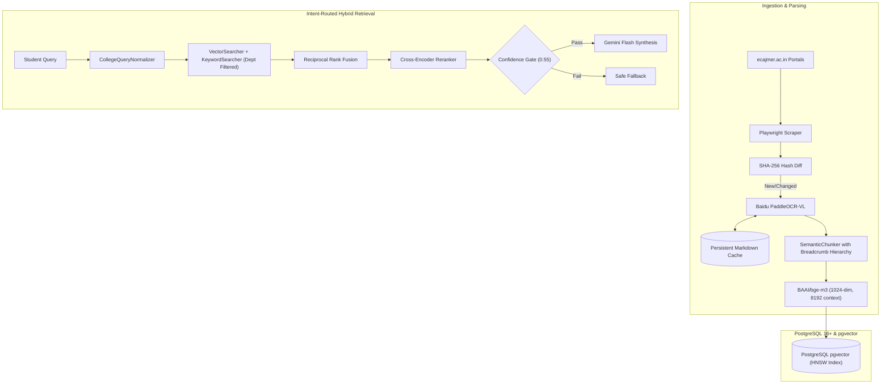

# EduSync Backend

FastAPI asynchronous backend for the EduSync self-updating RAG knowledge base chatbot.

---

## Architecture & Modules



```
/backend
  /alembic        Alembic migration scripts for PostgreSQL & pgvector schema
  /api            FastAPI routes, dependency injection, and configuration
    /routes       /chat, /admin/sources, /admin/departments, /health
  /db             Async SQLAlchemy engine & session maker
  /ingestion      Crawlers, Baidu OCR parser, SHA-256 hash-diffing, and BGE-M3 embedding
    /fetchers     ecajmer_fetcher.py (ECA institutional portal scraper)
  /models         SQLAlchemy ORM models (Document, Chunk, Conflict, IngestionSource, Department)
  /models_cache   100% offline local model weights (bge-m3, ms-marco-MiniLM-L-6-v2)
  /retrieval      HybridSearcher (pgvector 1024d + BM25 via RRF), CrossEncoderReranker, ConfidenceGate
  /scripts        manage_models.py, seed_sources.py
  /tests          Pytest async unit, mock, and integration test suite (117 tests)
```

---

## Setup & Execution

### 1. Python Virtual Environment
```bash
python -m venv .venv
# On Windows:
.\.venv\Scripts\Activate.ps1
# On Linux/macOS:
# source .venv/bin/activate

pip install -r requirements.txt
```

### 2. Download Local AI Models (BAAI/bge-m3 & ms-marco-MiniLM)
```bash
python scripts/manage_models.py
```
This downloads `BAAI/bge-m3` weights directly into `backend/models_cache/bge-m3` for 100% offline, zero-warning CPU execution, and cleans up obsolete local models.

### 3. Database Migrations
```bash
alembic upgrade head
```

### 4. Run Development Server
```bash
uvicorn api.main:app --reload --port 8000
```

---

## API Endpoints

| Method | Endpoint | Description |
| :--- | :--- | :--- |
| `POST` | `/chat` | Grounded RAG query endpoint returning synthesized answer, tables, & citations |
| `GET` | `/admin/sources` | List all configured data source endpoints with statistics |
| `POST` | `/admin/sources` | Register a new prioritized institutional source URL |
| `PUT` | `/admin/sources/{id}` | Update source configuration (limits, active state, priority) |
| `DELETE` | `/admin/sources/{id}` | Remove a data source from ingestion schedule |
| `POST` | `/admin/sources/{id}/fetch` | Trigger on-demand crawler & embedding task for a source |
| `GET` | `/admin/sources/{id}/documents` | Retrieve stored notices in exact chronological portal sequence |
| `GET` | `/admin/sources/{id}/documents/{doc_id}/chunks` | Inspect extracted chunks, contextual headers, and tokens |
| `GET` | `/admin/sources/{id}/live-feed` | Live proxy of ECA portal circular API without browser CORS blocks |
| `POST` | `/admin/sources/seed-defaults` | Preload all official ECA departmental sources |
| `GET` | `/admin/sources/live-progress` | Real-time pipeline step execution status for the Live Inspector |
| `GET` | `/admin/departments` | List all registered academic and administrative departments |
| `GET` | `/admin/jina-usage` | Real-time token usage stats vs 10M free limit |
| `GET` | `/health` | System health check (DB connectivity & status) |

---

## Testing & Code Quality

```bash
pytest              # Run full async test suite (117 tests)
ruff check .        # Lint check
black --check .     # Code format check
```

