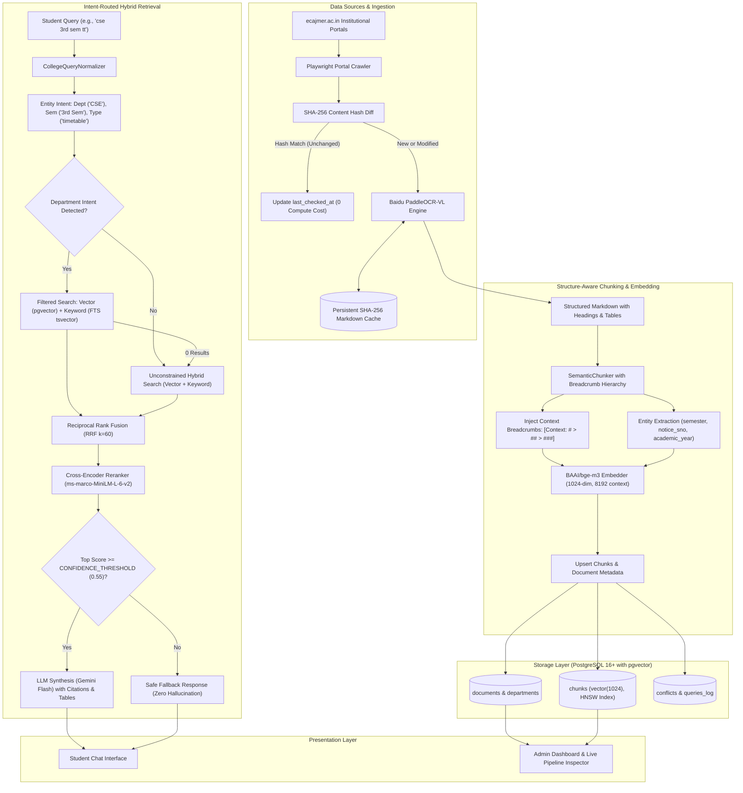

# Technical Design Document (TDD)
## EduSync — Self-Updating Retrieval-Augmented Knowledge Base Chatbot

**Version:** 1.0
**Status:** Draft
**Related Docs:** `EduSync_PRD.md`, Project Synopsis (`Project_Synopsis.docx`)
**Last Updated:** July 25, 2026

---

## 1. Purpose & Scope

This document translates the PRD's functional requirements into concrete technical decisions: architecture, data schemas, algorithms, APIs, and deployment design. It is the implementation reference for the 4-person team; the PRD stays the source of truth for *what* and *why*, this document is the *how*.

---

## 2. Tech Stack Decisions

| Layer | Choice | Rationale |
|---|---|---|
| Backend API | Python 3.11+ + FastAPI | Async support, native fit with ML/embedding libraries, auto-generated OpenAPI docs |
| Ingestion Workers | Python (Async in-process for dev; Celery + Redis for prod) | In-process execution for zero-Docker local development; Celery + Redis for production with retry/backoff |
| Document OCR | Baidu PaddleOCR-VL + Persistent SHA-256 Cache | Direct Markdown output with native tables, heading hierarchy, and zero redundant OCR via `.cache/ocr_markdown/` |
| Embeddings | BAAI/bge-m3 (`1024` dimensions, 8,192 token context) | High-recall bilingual (Hindi+English) embedding, cached locally in `models_cache/bge-m3` for 100% offline CPU execution |
| Vector Store | pgvector (PostgreSQL extension, HNSW cosine index) | Unified storage for relational metadata and 1024-dim dense embeddings (`m=16, ef_construction=64`) |
| Relational Store | PostgreSQL 16+ | Stores documents, departments, ingestion sources, chunks, conflicts, and query logs with full type-safety |
| LLM (generation) | Gemini 2.5 Flash (`google-genai`), OpenAI/Claude fallback | High-speed grounded answer generation with native table rendering and source citations |
| Reranker | Cross-encoder (`ms-marco-MiniLM-L-6-v2`) | Rescores top-k fused candidates to eliminate false positives before hitting the LLM |
| Frontend | React 18 + TypeScript + Tailwind CSS | Minimal, accessible UI with Lucide icons (zero emojis), live pipeline inspector with 5s auto-polling |
| Deployment | Native Local Dev (Python venv + Node) / Docker Compose | Fast local development without Docker; containerized deployments for cloud and staging parity |

---

## 3. High-Level Architecture



---

## 4. Database Schema (PostgreSQL DDL)

```sql
CREATE TABLE departments (
    id          UUID PRIMARY KEY DEFAULT gen_random_uuid(),
    name        TEXT NOT NULL UNIQUE,
    code        TEXT NOT NULL UNIQUE,
    created_at  TIMESTAMPTZ NOT NULL DEFAULT now()
);

CREATE TABLE ingestion_sources (
    id              UUID PRIMARY KEY DEFAULT gen_random_uuid(),
    department_id   UUID REFERENCES departments(id) ON DELETE SET NULL,
    portal_url      TEXT NOT NULL UNIQUE,
    priority        INT NOT NULL DEFAULT 5,
    max_pages       INT NOT NULL DEFAULT 3,
    is_active       BOOLEAN NOT NULL DEFAULT true,
    last_scraped_at TIMESTAMPTZ,
    created_at      TIMESTAMPTZ NOT NULL DEFAULT now()
);

CREATE TABLE documents (
    id              UUID PRIMARY KEY DEFAULT gen_random_uuid(),
    source_url      TEXT NOT NULL,
    source_type     TEXT NOT NULL CHECK (source_type IN ('pdf', 'html', 'sheet')),
    department      TEXT,
    owner           TEXT,
    content_hash    TEXT NOT NULL,
    status          TEXT NOT NULL DEFAULT 'fresh'
                        CHECK (status IN ('fresh', 'stale', 'conflicted', 'pending')),
    ingested_at     TIMESTAMPTZ NOT NULL DEFAULT now(),
    last_checked_at TIMESTAMPTZ NOT NULL DEFAULT now()
);

CREATE TABLE chunks (
    id              UUID PRIMARY KEY DEFAULT gen_random_uuid(),
    document_id     UUID NOT NULL REFERENCES documents(id) ON DELETE CASCADE,
    content         TEXT NOT NULL,
    token_count     INT NOT NULL,
    embedding       VECTOR(1024),          -- 1024-dim BAAI/bge-m3 embedding
    last_verified   TIMESTAMPTZ NOT NULL DEFAULT now()
);
CREATE INDEX chunks_embedding_idx ON chunks 
    USING hnsw (embedding vector_cosine_ops)
    WITH (m = 16, ef_construction = 64);

CREATE TABLE conflicts (
    id              UUID PRIMARY KEY DEFAULT gen_random_uuid(),
    document_ids    UUID[] NOT NULL,
    detected_at     TIMESTAMPTZ NOT NULL DEFAULT now(),
    resolved_by     TEXT,
    resolved_at     TIMESTAMPTZ,
    resolution_note TEXT
);

CREATE TABLE queries_log (
    id                  UUID PRIMARY KEY DEFAULT gen_random_uuid(),
    question            TEXT NOT NULL,
    retrieved_chunk_ids UUID[],
    answer              TEXT,
    confidence_score    NUMERIC(4,3),
    feedback            TEXT CHECK (feedback IN ('up', 'down') OR feedback IS NULL),
    created_at          TIMESTAMPTZ NOT NULL DEFAULT now()
);
```

---

## 5. Core Algorithms

### 5.1 Change Detection (Hash Diff & Persistent OCR Cache)
```
for each registered source in ingestion_sources:
    fetch raw document content (PDF/HTML)
    new_hash = SHA256(raw_content)
    if new_hash != documents.content_hash:
        check local persistent OCR cache (.cache/ocr_markdown/{hash}.md)
        if cached:
            markdown = read_cache()
        else:
            markdown = baidu_paddleocr_vl(raw_content)
            save_cache(new_hash, markdown)
        chunk, embed with BGE-M3, and upsert
    else:
        update documents.last_checked_at (0 compute and 0 embedding cost)
```

### 5.2 Structure-Aware Markdown Chunking & Breadcrumbs
- **Heading Stack Hierarchy**: Baidu OCR output is parsed into Markdown sections while maintaining a heading stack (`# > ## > ### > ####`).
- **Context Injection**: Each child paragraph and table chunk is prepended with `[Context: Breadcrumb Path]\n\n`, allowing dense vectors and keyword FTS to match hierarchical section context.
- **Entity Extraction**: Regex extractors pull key metadata fields:
  - `semester`: e.g. `3rd Sem`, `1st Sem`
  - `notice_sno`: Official dispatch code (e.g. `ECA/Acad/2026/1042`, `F.(2)/Admin/Estt/2025/89`)
  - `academic_year`: e.g. `2025-26`, `2026-2027`
- **Atomic Tables**: Markdown tables are kept intact as dedicated chunks with natural language row statements and breadcrumb headers.
- **Target Size**: 800 tokens target (up to 1,200 max) to fully exploit BGE-M3's 8,192 token window.

### 5.3 Intent-Routed Hybrid Retrieval & Reranking
```
1. norm = CollegeQueryNormalizer.normalize(query)
   -> extracts detected_departments, detected_semesters, expanded_vector, expanded_keyword
2. if norm.detected_departments:
       vector_results = ANN_search(norm.expanded_vector, filter=departments, top_k=20)
       keyword_results = FTS_search(norm.expanded_keyword, filter=departments, top_k=20)
3. if not vector_results and not keyword_results: # Resilient fallback
       vector_results = ANN_search(norm.expanded_vector, filter=None, top_k=20)
       keyword_results = FTS_search(norm.expanded_keyword, filter=None, top_k=20)
4. fused_chunks = Reciprocal_Rank_Fusion(vector_results, keyword_results, k=60)
5. reranked = CrossEncoder_Rerank(query, fused_chunks)
6. if reranked[0].score < CONFIDENCE_THRESHOLD (0.55):
       return fallback_response() # Zero hallucination
   else:
       return generate_answer(query, reranked[:5]) # Gemini synthesis with citations
```
`CONFIDENCE_THRESHOLD` is strictly calibrated at `0.55`.

### 5.4 Conflict Detection
When two active documents are tagged with overlapping `department` + a matching document "type" heuristic (e.g., both classified as "exam schedule" via a lightweight classifier or filename/keyword rule) and their content disagrees on a extracted key fact (date, amount), flag a `conflicts` row instead of silently ingesting both as retrievable. Documents in `conflicts` are strictly excluded from retrieval until administrative resolution.

---

## 6. API Design (FastAPI)

| Method | Endpoint | Description |
|---|---|---|
| `POST` | `/chat` | `{ "question": str }` → `{ answer, sources[], confidence }` |
| `POST` | `/feedback` | `{ query_id, feedback: "up"/"down" }` |
| `GET` | `/admin/documents` | List all documents with status |
| `POST` | `/admin/documents/{id}/reingest` | Force re-ingestion of one source |
| `GET` | `/admin/conflicts` | List unresolved conflicts |
| `POST` | `/admin/conflicts/{id}/resolve` | `{ authoritative_document_id, note }` |
| `GET` | `/admin/analytics` | Query volume, top unanswered questions, feedback breakdown |

Example response from `/chat`:
```json
{
  "answer": "The mid-semester exams begin on 14 September 2026.",
  "sources": [
    {
      "document": "Mid-Sem Exam Schedule Circular",
      "last_verified": "2026-07-20T10:00:00Z",
      "url": "https://college.edu/circulars/exam-sched.pdf"
    }
  ],
  "confidence": 0.82
}
```

---

## 7. Sequence: Self-Updating Flow

```
Celery Beat (every 6h)
     │
     ▼
Ingestion Worker: fetch source → hash compare
     │
     ├── unchanged → update last_checked_at, exit
     │
     └── changed
           │
           ▼
     Parse & chunk → tag metadata → embed changed chunks
           │
           ▼
     Upsert into vector store + Postgres (chunks, documents)
           │
           ▼
     Run conflict check against same-department/type docs
           │
           ├── conflict found → create `conflicts` row, status='conflicted'
           │
           └── no conflict → status='fresh', last_verified=now()
```

---

## 8. Error Handling & Resilience

| Failure Mode | Handling |
|---|---|
| Source fetch fails (timeout, 404) | Retry 3x with exponential backoff (Celery); log failure; keep last-known-good chunks live |
| Embedding API rate-limited | Queue and retry; batch embed requests where possible |
| LLM API outage (primary) | Fall back to secondary provider; if both fail, return a static "service temporarily unavailable" message, never a hallucinated guess |
| Conflicting sources not yet resolved | Exclude both from retrieval until admin resolves, rather than guessing which is correct |
| Malformed/corrupt PDF | Log and skip; flag in admin dashboard for manual review |

---

## 9. Testing Strategy

- **Unit tests:** chunking boundaries, hash-diff logic, conflict-detection heuristic.
- **Integration tests:** full ingestion → retrieval → generation flow against a fixture set of sample documents.
- **Evaluation harness (offline):** run the 100-question test set nightly in CI; track precision@5, answer accuracy, and confidence-threshold calibration over time.
- **Ablation testing:** identical test set run against a "static" build (self-update disabled) to produce the Sem 8 comparison report.
- **Manual QA:** weekly team review of real chat logs for hallucination/fallback correctness.

---

## 10. Deployment Design

- **Local Development (Non-Docker App Execution):** Native Python virtual environment (Python 3.11+) running FastAPI via `uvicorn` and React frontend (Node 20+) via Vite (`npm run dev`), connected to local PostgreSQL with pgvector, with background tasks executing in-process (Celery eager mode).
- **Staging & Production:** Docker Compose / containerized single VM (or Render/Railway) running FastAPI, Postgres+pgvector, Redis, Celery worker, and built static frontend.
- **CI/CD:** GitHub Actions — run backend tests (`pytest`, `ruff`, `black`) and frontend tests (`npm test`, `npm run lint`) directly on host runners on PR; build Docker images on merge to `main`.
- **Secrets:** LLM/embedding API keys stored in environment variables / GitHub Actions secrets, never committed.

---

## 11. Open Technical Decisions

- Exact reranker choice (self-hosted cross-encoder vs. Cohere Rerank API) — depends on latency budget once end-to-end timing is measured.
- Whether conflict-type classification (Section 5.4) is a rule-based heuristic or a small trained classifier — start rule-based, revisit if false-positive rate is high.
- Embedding dimensionality and cost tradeoff for the pgvector column once the production embedding model is finalized.
