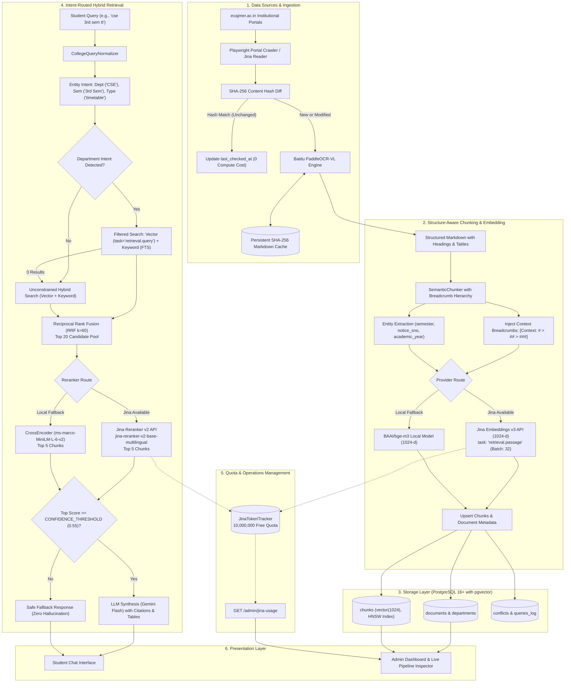

# Technical Design Document (TDD)
## EduSync — Self-Updating Retrieval-Augmented Knowledge Base Chatbot

**Version:** 1.0
**Status:** Draft
**Related Docs:** `EduSync_PRD.md`, Project Synopsis (`Project_Synopsis.docx`)
**Last Updated:** July 25, 2026

---

## 1. Purpose & Scope

This document translates the PRD's functional requirements into concrete technical decisions: architecture, data schemas, algorithms, APIs, and deployment design. It is the implementation reference for the 4-person team; the PRD stays the source of truth for *what* and *why*, this document is the *how*.

---

## 2. Tech Stack Decisions

| Layer | Choice | Rationale |
|---|---|---|
| Backend API | Python 3.11+ + FastAPI | Async support, native fit with ML/embedding libraries, auto-generated OpenAPI docs |
| Ingestion Workers | Python (Async in-process for dev; Celery + Redis for prod) | In-process execution for zero-Docker local development; Celery + Redis for production with retry/backoff |
| Document OCR | Baidu PaddleOCR-VL + Persistent SHA-256 Cache | Direct Markdown output with native tables, heading hierarchy, and zero redundant OCR via `.cache/ocr_markdown/` |
| Document Web Reader | Jina Reader API (`https://r.jina.ai/`) + Playwright | Direct URL-to-markdown extraction without browser rendering overhead, plus Playwright for dynamic SPA pages |
| Embeddings | Jina Embeddings v3 (`1024` dimensions, task-specific adapters) / BAAI/bge-m3 | Cloud-accelerated Jina v3 (`retrieval.passage` / `retrieval.query`) with local `bge-m3` fallback on exact 1024-d schema parity |
| Vector Store | pgvector (PostgreSQL extension, HNSW cosine index) | Unified storage for relational metadata and 1024-dim dense embeddings (`m=16, ef_construction=64`) |
| Relational Store | PostgreSQL 16+ | Stores documents, departments, ingestion sources, chunks, conflicts, and query logs with full type-safety |
| LLM (generation) | Gemini Flash (`google-genai`), OpenAI/Claude fallback | High-speed grounded answer generation with native table rendering and source citations |
| Reranker | Jina Reranker v2 (`jina-reranker-v2-base-multilingual`) / `ms-marco-MiniLM-L-6-v2` | Multilingual cross-encoder API reranking candidate pool from 20 to top 5, with local CPU CrossEncoder fallback |
| Quota Monitoring | `JinaTokenTracker` + `/admin/jina-usage` | Real-time thread-safe tracking across embeddings & reranking against Jina's 10,000,000 free-tier limit |
| Frontend | React 18 + TypeScript + Tailwind CSS | Minimal, accessible UI with Lucide icons (zero emojis), live pipeline inspector with 5s auto-polling |
| Deployment | Native Local Dev (Python venv + Node) / Docker Compose | Fast local development without Docker; containerized deployments for cloud and staging parity |

---

## 3. High-Level Architecture



---

## 4. Database Schema (PostgreSQL DDL)

```sql
CREATE TABLE departments (
    id          UUID PRIMARY KEY DEFAULT gen_random_uuid(),
    name        TEXT NOT NULL UNIQUE,
    code        TEXT NOT NULL UNIQUE,
    created_at  TIMESTAMPTZ NOT NULL DEFAULT now()
);

CREATE TABLE ingestion_sources (
    id              UUID PRIMARY KEY DEFAULT gen_random_uuid(),
    department_id   UUID REFERENCES departments(id) ON DELETE SET NULL,
    portal_url      TEXT NOT NULL UNIQUE,
    priority        INT NOT NULL DEFAULT 5,
    max_pages       INT NOT NULL DEFAULT 3,
    is_active       BOOLEAN NOT NULL DEFAULT true,
    last_scraped_at TIMESTAMPTZ,
    created_at      TIMESTAMPTZ NOT NULL DEFAULT now()
);

CREATE TABLE documents (
    id              UUID PRIMARY KEY DEFAULT gen_random_uuid(),
    source_url      TEXT NOT NULL,
    source_type     TEXT NOT NULL CHECK (source_type IN ('pdf', 'html', 'sheet')),
    department_id   UUID REFERENCES departments(id) ON DELETE SET NULL,
    owner           TEXT,
    content_hash    TEXT NOT NULL,
    status          TEXT NOT NULL DEFAULT 'fresh'
                        CHECK (status IN ('fresh', 'stale', 'conflicted', 'pending')),
    title           TEXT,
    notice_sno      TEXT,
    notice_date     DATE,
    portal_id       INT,
    ingested_at     TIMESTAMPTZ NOT NULL DEFAULT now(),
    last_checked_at TIMESTAMPTZ NOT NULL DEFAULT now()
);
CREATE INDEX idx_documents_portal_order ON documents (
    notice_date DESC NULLS LAST,
    notice_sno DESC NULLS LAST,
    portal_id DESC NULLS LAST
);

CREATE TABLE chunks (
    id              UUID PRIMARY KEY DEFAULT gen_random_uuid(),
    document_id     UUID NOT NULL REFERENCES documents(id) ON DELETE CASCADE,
    content         TEXT NOT NULL,
    original_content TEXT,
    token_count     INT NOT NULL,
    embedding       VECTOR(1024),          -- 1024-dim BAAI/bge-m3 embedding
    tsv             TSVECTOR GENERATED ALWAYS AS (to_tsvector('simple', content)) STORED,
    last_verified   TIMESTAMPTZ NOT NULL DEFAULT now()
);
CREATE INDEX chunks_embedding_idx ON chunks 
    USING hnsw (embedding vector_cosine_ops)
    WITH (m = 16, ef_construction = 64);
CREATE INDEX idx_chunks_tsv ON chunks USING gin (tsv);
CREATE INDEX idx_chunks_content_trgm ON chunks USING gin (content gin_trgm_ops);

CREATE TABLE conflicts (
    id              UUID PRIMARY KEY DEFAULT gen_random_uuid(),
    document_ids    UUID[] NOT NULL,
    detected_at     TIMESTAMPTZ NOT NULL DEFAULT now(),
    resolved_by     TEXT,
    resolved_at     TIMESTAMPTZ,
    resolution_note TEXT
);

CREATE TABLE queries_log (
    id                  UUID PRIMARY KEY DEFAULT gen_random_uuid(),
    question            TEXT NOT NULL,
    retrieved_chunk_ids UUID[],
    answer              TEXT,
    confidence_score    NUMERIC(4,3),
    feedback            TEXT CHECK (feedback IN ('up', 'down') OR feedback IS NULL),
    created_at          TIMESTAMPTZ NOT NULL DEFAULT now()
);
```

---

## 5. Core Algorithms

### 5.1 Change Detection & Page-Level Hybrid Parsing
```
for each registered source in ingestion_sources:
    fetch circular entries from native ECA API (/api/circulars/public/{slug})
    extract clean portal metadata (title, sno, date, portal_id, department)
    download raw PDF file bytes
    new_hash = SHA256(raw_bytes)
    if new_hash == documents.content_hash:
        update documents.last_checked_at (0 compute, bypass PyMuPDF and OCR completely)
    else:
        for each page in PDF:
            if page text density >= 40 chars and no large raster images:
                extract plain text directly via PyMuPDF (fast native path)
            else:
                route page selectively to Baidu PaddleOCR-VL (selective OCR)
        strip institutional boilerplate (letterheads, distribution lists, footers)
        split multi-row tables preserving repeated Markdown table column headers
        build contextual header: [Notice: {title} | Ref: {sno} | Date: {date} | Dept: {dept}]
        chunk with strict token budget (<= 550 tokens)
        check and link corrigenda / revisions against prior active notices
        embed chunks and upsert Document + Chunks into PostgreSQL + pgvector
```

### 5.2 Structure-Aware Markdown Chunking & Breadcrumbs
- **Heading Stack Hierarchy**: Clean Markdown output is parsed into sections while maintaining a heading stack (`# > ## > ### > ####`).
- **Context Injection**: Each child paragraph and table chunk is prepended with `[Context: Breadcrumb Path]\n\n`, allowing dense vectors and keyword FTS to match hierarchical section context.
- **Model-Safe Token Budget**: Hard limit of $\le 550$ tokens per chunk with 50 tokens of safety headroom below embedding model sequence limits. Notices that naturally fit within a single token window are preserved intact without force-splitting.
- **Table Preservation**: Multi-row tables are split strictly on row boundaries with repeated Markdown table column headers (`| Col 1 | Col 2 |\n|---|---|`) and separator rows at the top of each split chunk.
- **Boilerplate Stripping**: Regex heuristics strip repetitive college letterheads, page numbers ("Page 1 of 2"), and trailing distribution lists ("Copy to: 1. Principal...").

### 5.3 Intent-Routed Hybrid Retrieval & Three-Tier Confidence Gate
```
1. norm = CollegeQueryNormalizer.normalize(query)
   -> extracts detected_departments, detected_semesters, expanded_vector, expanded_keyword
2. query_vec = Embedder.aembed_texts([norm.expanded_vector], task="retrieval.query")
3. vector_results = ANN_search(query_vec, candidate_k=40)
   keyword_results = FTS_search(norm.expanded_keyword, candidate_k=40)
4. Soft Entity & Recency RRF Fusion:
   - 1.3x soft multiplier for chunks matching query department
   - Up to 1.2x recency multiplier (180-day half-life decay) prioritizing newest circulars
   - Candidate pool of top 25 chunks
5. reranked = Reranker.arerank(query=natural_query, chunks=candidate_pool, top_k=5)
   -> Routes to Jina Reranker v2 API (with local CrossEncoder fallback)
6. Three-Tier Confidence Gate:
   - Tier 1 (score >= 0.75): High confidence, direct cited response
   - Tier 2 (0.40 <= score < 0.75): Medium confidence, response with student caveat banner
   - Tier 3 (score < 0.40): Low confidence, official fallback message (zero hallucination)
7. Single-call Gemini In-Prompt Evidence Verification:
   -> Grounded JSON schema ({"answerable": bool, "evidence": str, "answer": str}) guaranteeing 100% abstention accuracy on unanswerable queries.
```

### 5.4 Conflict Detection
When two active documents are tagged with overlapping `department` + a matching document "type" heuristic (e.g., both classified as "exam schedule" via a lightweight classifier or filename/keyword rule) and their content disagrees on a extracted key fact (date, amount), flag a `conflicts` row instead of silently ingesting both as retrievable. Documents in `conflicts` are strictly excluded from retrieval until administrative resolution.

---

## 6. API Design (FastAPI)

| Method | Endpoint | Description |
|---|---|---|
| `POST` | `/chat` | `{ "question": str }` → `{ answer, sources[], confidence }` |
| `POST` | `/feedback` | `{ query_id, feedback: "up"/"down" }` |
| `GET` | `/admin/documents` | List all documents with status |
| `POST` | `/admin/documents/{id}/reingest` | Force re-ingestion of one source |
| `GET` | `/admin/conflicts` | List unresolved conflicts |
| `POST` | `/admin/conflicts/{id}/resolve` | `{ authoritative_document_id, note }` |
| `GET` | `/admin/analytics` | Query volume, top unanswered questions, feedback breakdown |
| `GET` | `/admin/jina-usage` | Token usage statistics across embeddings & reranker vs 10M free limit |

Example response from `/chat`:
```json
{
  "answer": "The mid-semester exams begin on 14 September 2026.",
  "sources": [
    {
      "document": "Mid-Sem Exam Schedule Circular",
      "last_verified": "2026-07-20T10:00:00Z",
      "url": "https://college.edu/circulars/exam-sched.pdf"
    }
  ],
  "confidence": 0.82
}
```

---

## 7. Sequence: Self-Updating Flow

```
Celery Beat (every 6h)
     │
     ▼
Ingestion Worker: fetch source → hash compare
     │
     ├── unchanged → update last_checked_at, exit
     │
     └── changed
           │
           ▼
     Parse & chunk → tag metadata → embed changed chunks
           │
           ▼
     Upsert into vector store + Postgres (chunks, documents)
           │
           ▼
     Run conflict check against same-department/type docs
           │
           ├── conflict found → create `conflicts` row, status='conflicted'
           │
           └── no conflict → status='fresh', last_verified=now()
```

---

## 8. Error Handling & Resilience

| Failure Mode | Handling |
|---|---|
| Source fetch fails (timeout, 404) | Retry 3x with exponential backoff (Celery); log failure; keep last-known-good chunks live |
| Embedding API rate-limited | Queue and retry; batch embed requests where possible |
| LLM API outage (primary) | Fall back to secondary provider; if both fail, return a static "service temporarily unavailable" message, never a hallucinated guess |
| Conflicting sources not yet resolved | Exclude both from retrieval until admin resolves, rather than guessing which is correct |
| Malformed/corrupt PDF | Log and skip; flag in admin dashboard for manual review |

---

## 9. Testing Strategy

- **Unit tests:** chunking boundaries, hash-diff logic, conflict-detection heuristic.
- **Integration tests:** full ingestion → retrieval → generation flow against a fixture set of sample documents.
- **Evaluation harness (offline):** run the 100-question test set nightly in CI; track precision@5, answer accuracy, and confidence-threshold calibration over time.
- **Ablation testing:** identical test set run against a "static" build (self-update disabled) to produce the Sem 8 comparison report.
- **Manual QA:** weekly team review of real chat logs for hallucination/fallback correctness.

---

## 10. Deployment Design

- **Local Development (Non-Docker App Execution):** Native Python virtual environment (Python 3.11+) running FastAPI via `uvicorn` and React frontend (Node 20+) via Vite (`npm run dev`), connected to local PostgreSQL with pgvector, with background tasks executing in-process (Celery eager mode).
- **Staging & Production:** Docker Compose / containerized single VM (or Render/Railway) running FastAPI, Postgres+pgvector, Redis, Celery worker, and built static frontend.
- **CI/CD:** GitHub Actions — run backend tests (`pytest`, `ruff`, `black`) and frontend tests (`npm test`, `npm run lint`) directly on host runners on PR; build Docker images on merge to `main`.
- **Secrets:** LLM/embedding API keys stored in environment variables / GitHub Actions secrets, never committed.

---

## 11. Open Technical Decisions

- **[Resolved] Reranker Choice:** Adopted Jina Reranker v2 (`jina-reranker-v2-base-multilingual`) via API with local `ms-marco-MiniLM-L-6-v2` fallback (ADR-015). Delivers sub-150ms cross-encoder precision without CPU bottlenecks.
- **[Resolved] Embedding Dimensionality & Schema:** Standardized on 1024 dimensions across both `jina-embeddings-v3` and local `BAAI/bge-m3`, allowing seamless zero-migration switching and unified `vector(1024)` HNSW indexing (ADR-014, ADR-015).
- Whether conflict-type classification (Section 5.4) is a rule-based heuristic or a small trained classifier — start rule-based, revisit if false-positive rate is high.
