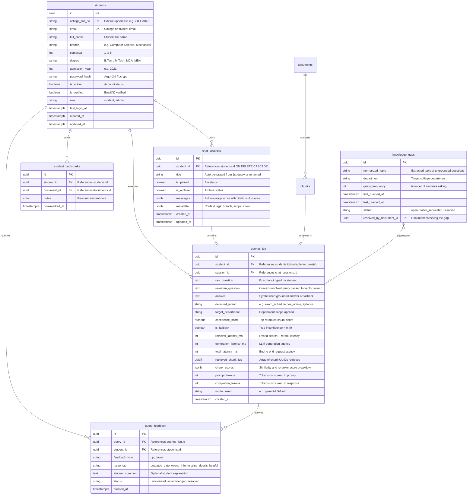

# EduSync Database Expansion Architecture & Telemetry Plan

This document establishes the architecture, database schema, Alembic migration strategy, telemetry tracking models, and API contracts for expanding EduSync to support **authenticated multi-student user registration**, **database-backed chat session isolation (recents, pinned, archived)**, and **system improvement telemetry (knowledge gap detection, latency metrics, structured student feedback)** with **zero dummy data**.

---

## 1. Executive Summary & Design Principles

1. **Strict Relational Isolation**: Every student account has unique institutional credentials (`college_roll_no`, `email`). All chat sessions, pinned conversations, and archived transcripts are bound by foreign keys to the authenticated student ID.
2. **Zero Dummy Data**: The frontend operates 100% dynamically via REST API endpoints backed by PostgreSQL. When a student registers or logs in, their conversation list is fetched live from the database. Fresh accounts start with a clean state and actual college sample prompts.
3. **Data-Driven Improvement Layer**: The database will capture telemetry that empowers both administrators and ML engineers to continuously improve the RAG pipeline:
   - **Knowledge Gap Detection**: Automatically flags recurring unanswered questions where confidence was below threshold (< 0.40), alerting college admins to missing institutional circulars.
   - **Conversational Query Rewriting Telemetry**: Logs raw vs rewritten queries to measure how effectively conversation history resolves pronouns and references.
   - **Academic Context Grounding**: Stores student branch and semester metadata to personalize retrieval filtering (e.g., automatically prioritizing 6th-semester CSE circulars).

---

## 2. Entity Relationship Diagram (ERD)



---

## 3. Database Schema Specifications (DDL)

### 3.1. `students` Table
```sql
CREATE TABLE students (
    id UUID PRIMARY KEY DEFAULT gen_random_uuid(),
    college_roll_no VARCHAR(50) NOT NULL,
    email VARCHAR(255) NOT NULL,
    full_name VARCHAR(150) NOT NULL,
    branch VARCHAR(100) NOT NULL,
    semester SMALLINT NOT NULL CHECK (semester BETWEEN 1 AND 8),
    degree VARCHAR(50) NOT NULL DEFAULT 'B.Tech' CHECK (degree IN ('B.Tech', 'M.Tech', 'MCA', 'MBA')),
    admission_year SMALLINT NOT NULL,
    password_hash VARCHAR(255) NOT NULL,
    is_active BOOLEAN NOT NULL DEFAULT TRUE,
    is_verified BOOLEAN NOT NULL DEFAULT FALSE,
    role VARCHAR(20) NOT NULL DEFAULT 'student' CHECK (role IN ('student', 'admin')),
    last_login_at TIMESTAMPTZ,
    created_at TIMESTAMPTZ NOT NULL DEFAULT CURRENT_TIMESTAMP,
    updated_at TIMESTAMPTZ NOT NULL DEFAULT CURRENT_TIMESTAMP
);

CREATE UNIQUE INDEX uq_students_roll_no ON students (UPPER(college_roll_no));
CREATE UNIQUE INDEX uq_students_email ON students (LOWER(email));
CREATE INDEX ix_students_branch_semester ON students (branch, semester);
```

### 3.2. Upgraded `chat_sessions` Table
```sql
-- Migration: Alter existing chat_sessions table to link with students
ALTER TABLE chat_sessions 
    ALTER COLUMN student_id TYPE UUID USING student_id::uuid,
    ADD CONSTRAINT fk_chat_sessions_student 
        FOREIGN KEY (student_id) REFERENCES students(id) ON DELETE CASCADE,
    ADD COLUMN IF NOT EXISTS metadata JSONB NOT NULL DEFAULT '{}'::jsonb;

CREATE INDEX IF NOT EXISTS ix_chat_sessions_lookup 
    ON chat_sessions (student_id, is_archived, is_pinned, updated_at DESC);
```

### 3.3. Expanded `queries_log` Telemetry Table
```sql
ALTER TABLE queries_log
    ADD COLUMN IF NOT EXISTS session_id UUID REFERENCES chat_sessions(id) ON DELETE SET NULL,
    ADD COLUMN IF NOT EXISTS student_id UUID REFERENCES students(id) ON DELETE SET NULL,
    ADD COLUMN IF NOT EXISTS raw_question TEXT,
    ADD COLUMN IF NOT EXISTS rewritten_question TEXT,
    ADD COLUMN IF NOT EXISTS detected_intent VARCHAR(50),
    ADD COLUMN IF NOT EXISTS target_department VARCHAR(100),
    ADD COLUMN IF NOT EXISTS is_fallback BOOLEAN DEFAULT FALSE,
    ADD COLUMN IF NOT EXISTS retrieval_latency_ms INTEGER,
    ADD COLUMN IF NOT EXISTS generation_latency_ms INTEGER,
    ADD COLUMN IF NOT EXISTS total_latency_ms INTEGER,
    ADD COLUMN IF NOT EXISTS chunk_scores JSONB DEFAULT '{}'::jsonb,
    ADD COLUMN IF NOT EXISTS prompt_tokens INTEGER,
    ADD COLUMN IF NOT EXISTS completion_tokens INTEGER,
    ADD COLUMN IF NOT EXISTS model_used VARCHAR(50);

CREATE INDEX IF NOT EXISTS ix_queries_log_session ON queries_log (session_id);
CREATE INDEX IF NOT EXISTS ix_queries_log_student ON queries_log (student_id);
CREATE INDEX IF NOT EXISTS ix_queries_log_fallback ON queries_log (is_fallback, created_at DESC);
```

### 3.4. `knowledge_gaps` Table
```sql
CREATE TABLE knowledge_gaps (
    id UUID PRIMARY KEY DEFAULT gen_random_uuid(),
    normalized_topic VARCHAR(255) NOT NULL,
    department VARCHAR(100),
    query_frequency INTEGER NOT NULL DEFAULT 1,
    first_queried_at TIMESTAMPTZ NOT NULL DEFAULT CURRENT_TIMESTAMP,
    last_queried_at TIMESTAMPTZ NOT NULL DEFAULT CURRENT_TIMESTAMP,
    status VARCHAR(30) NOT NULL DEFAULT 'open' CHECK (status IN ('open', 'notice_requested', 'resolved')),
    resolved_by_document_id UUID REFERENCES documents(id) ON DELETE SET NULL
);

CREATE INDEX ix_knowledge_gaps_freq ON knowledge_gaps (query_frequency DESC, last_queried_at DESC);
```

---

## 4. How Additional Data Improves Future Pipeline Accuracy

| Metric / Field Captured | Location in DB | Specific Pipeline / Institutional Improvement |
| :--- | :--- | :--- |
| **`rewritten_question` vs `raw_question`** | `queries_log` | Measures the accuracy of multi-turn conversational query reformulation. Identifies when query rewriting loses context or misinterprets abbreviations (e.g. "when is it?" -> "mid-term exam schedule for CSE sem 6"). |
| **`is_fallback` & Knowledge Gaps** | `knowledge_gaps` | Detects institutional document deficits. When multiple students ask about a topic where confidence is below 0.40, administrators see an actionable notice gap (e.g. "15 students asked about odd-sem re-evaluation rules, no notice uploaded"). |
| **`branch` & `semester` Profile Context** | `students` | Enables personalized pre-filtering during dense retrieval. If a 3rd-year Mechanical student asks "when is my mid-term?", the retriever boosts chunks matching `branch: Mechanical` and `semester: 5`. |
| **`retrieval_latency_ms` & `generation_latency_ms`** | `queries_log` | Pinpoints RAG performance bottlenecks. Separates pgvector hybrid search latency from Gemini API generation latency for SLA monitoring. |
| **`chunk_scores` Breakdown** | `queries_log` | Stores both dense cosine similarity and BGE-Reranker cross-encoder scores. Provides ground truth dataset for tuning `CONFIDENCE_THRESHOLD` and re-ranking hyperparameters. |
| **Structured `issue_tag` Feedback** | `query_feedback` | Instead of binary thumbs up/down, tags like `outdated_date` flag superseded notices that slipped past conflict detection, driving immediate ingestion audits. |

---

## 5. REST API Specifications

### 5.1. Authentication & Student Profile Endpoints
- `POST /api/auth/register`: Register new student account (`college_roll_no`, `email`, `full_name`, `branch`, `semester`, `password`). Returns JWT access token.
- `POST /api/auth/login`: Authenticate with roll number/email and password. Returns JWT access token.
- `GET /api/auth/me`: Get current authenticated student profile (name, roll no, branch, semester).

### 5.2. Database-Driven Chat Session Endpoints
- `GET /api/chat/sessions`: Fetch all sessions belonging to the authenticated student (isolated by JWT). Supports `?archived=false` (active & pinned) and `?archived=true` (archive drawer).
- `POST /api/chat/sessions`: Create a new session in PostgreSQL. Returns session UUID.
- `GET /api/chat/sessions/{session_id}`: Fetch full transcript and message list from database.
- `PATCH /api/chat/sessions/{session_id}`: Rename title, toggle pin, or toggle archive.
- `DELETE /api/chat/sessions/{session_id}`: Permanent deletion from DB.

### 5.3. Telemetry & Query Endpoint
- `POST /api/chat`:
  - Request: `{ query: string, session_id: UUID, department?: string }`
  - Injects authenticated student's `branch` and `semester` into retrieval context.
  - Generates answer, calculates latency, computes token usage.
  - Automatically logs complete telemetry to `queries_log` and updates `chat_sessions.messages`.
  - If `is_fallback == true`, triggers background job to aggregate/update `knowledge_gaps`.

---

## 6. Implementation Sequencing (Milestones)

1. **Milestone A (Database Migrations)**:
   - Create Alembic migration for `students` table.
   - Upgrade `chat_sessions` to reference `students(id)` as foreign key.
   - Expand `queries_log` with latency, token, and session linkage fields.
   - Create `knowledge_gaps` and `query_feedback` tables.
2. **Milestone B (Backend Auth & Services)**:
   - Implement `backend/api/routes/auth.py` with password hashing (`pwdlib` / `passlib`) and JWT issuance (`pyjwt`).
   - Wire `get_current_student` dependency into `/chat` and `/chat/sessions` routes.
   - Implement background task for logging knowledge gap aggregations on low-confidence queries.
3. **Milestone C (Frontend Dynamic Data Integration)**:
   - Build Student Auth Modal (Register / Login) styled in EduSync light theme.
   - Replace local storage caching with React Query / live API fetching from `GET /api/chat/sessions`.
   - Ensure zero mock/dummy data; fresh accounts show clean empty state.
   - Display real student credentials in sidebar bottom profile.
4. **Milestone D (Verification & Testing)**:
   - Unit tests for registration, authentication, session isolation, and telemetry logging.
   - Verification with `black`, `ruff`, `pytest`, `npm test`, and `npm run build`.
